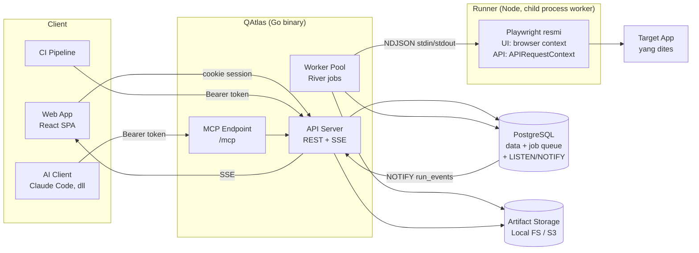

# 02 — Architecture

## Komponen



- **API Server**: REST JSON (`/api/v1/...`), SSE untuk progress run, serve artifact, serve static FE build (opsional, agar cukup satu container).
- **MCP Endpoint**: berjalan di proses yang sama dengan API server, memanggil service layer yang sama (bukan HTTP loopback).
- **Worker (Go)**: mengambil job dari River, mengirim rencana eksekusi ke runner, menerima event hasil, menulis hasil step ke DB, masking secret, upload artifact, kirim event live. Semua logika bisnis, concurrency, timeout global, dan cancel ada di sini.
- **Runner (Node + Playwright resmi)**: proses anak yang di-*supervise* worker. Tugasnya hanya mengeksekusi step DSL dengan API Playwright dan melaporkan hasil — tanpa akses DB, tanpa logika bisnis.
  - **UI step** — satu browser process per tipe browser, di-reuse; **satu browser context per run/test case** (context murah, browser mahal).
  - **HTTP step** — Playwright `APIRequestContext`. Jika ada browser context (shared session), dipakai `context.request` sehingga cookie login terbagi antara UI & API.
  - Browser hanya di-launch **lazily** jika test punya step UI.

## Protokol worker ↔ runner

NDJSON (satu JSON per baris) lewat stdin/stdout; stderr untuk log runner.

| Arah | Pesan | Isi |
|------|-------|-----|
| Go → Node | `run.start` | `run_id`, opsi (browser, viewport, screenshot, video, timeout), daftar case + step, variable ter-resolve (termasuk nilai secret — **hanya lewat stdin, di memori**, tidak lewat argv/env/file), `artifact_dir` sementara |
| Go → Node | `run.cancel` | `run_id` |
| Node → Go | `case.started`, `step.started` | posisi |
| Node → Go | `step.finished` | status, durasi, error (expected vs actual), path screenshot, detail HTTP ringkas, `vars` hasil `save`/`extract` |
| Node → Go | `case.finished` | status, path video |
| Node → Go | `run.finished` / `runner.error` | ringkasan / error infra |

- Satu proses runner **long-lived** per worker menangani beberapa run bersamaan (slot = `WORKER_CONCURRENCY`), berbagi browser process → hemat RAM.
- Interpolasi `{{vars.*}}` runtime terjadi di runner (karena nilainya lahir saat eksekusi); masking secret dilakukan di Go sebelum apa pun ditulis ke DB/log.
- Cancel: Go kirim `run.cancel`; jika tidak selesai dalam grace period, context ditutup paksa; jika runner hang/crash → proses di-kill & di-restart, run aktif ditandai `error`.
- Mode alternatif (lebih sederhana, isolasi lebih kuat): **satu proses runner per run**. Dipilih atau tidak berdasarkan hasil spike Phase 3.

## Mode binary

Satu binary `qatlas` dengan subcommand:

| Command | Fungsi |
|---------|--------|
| `qatlas server` | API + MCP + SSE (+ static FE) |
| `qatlas worker` | Worker pool saja (butuh Node + runner + browser Playwright terinstall) |
| `qatlas all` | Server + worker dalam satu proses — untuk instalasi kecil |
| `qatlas migrate up/down` | Migrasi DB |
| `qatlas user create-admin` | Bootstrap admin pertama |

Dipisah karena image worker berat (browser), sedangkan server ringan. Worker bisa di-scale horizontal; River menangani distribusi job antar worker.

## Model async run

```mermaid
sequenceDiagram
    participant FE
    participant API
    participant PG as Postgres (River)
    participant W as Worker (Go)
    participant R as Runner (Node+Playwright)
    participant ST as Storage

    FE->>API: POST /runs {target, env, options}
    API->>PG: BEGIN; insert run(status=queued) + snapshot; enqueue job; COMMIT
    API-->>FE: 202 {run_id}
    FE->>API: GET /runs/{id}/events (SSE)
    W->>PG: fetch job
    W->>PG: run.status=running, NOTIFY
    W->>R: run.start (rencana + variable)
    loop setiap step
        R->>R: eksekusi step via Playwright (timeout per step)
        R-->>W: step.finished (+ path screenshot)
        W->>ST: upload screenshot (sesuai opsi)
        W->>PG: insert run_step (secret dimask), NOTIFY
        PG-->>API: notification
        API-->>FE: event step_finished
    end
    R-->>W: case.finished (+ path video)
    W->>ST: upload video (sesuai opsi)
    W->>PG: run.status=passed/failed, summary, NOTIFY
    API-->>FE: event run_finished
```

- **Enqueue transaksional**: insert run dan enqueue job dalam satu transaksi → tidak ada run "yatim".
- **Concurrency**: `WORKER_CONCURRENCY` (default konservatif, mis. 2 per worker) membatasi jumlah browser context paralel → RAM terkendali.
- **Timeout**: per step (default 10s), per test case, dan per run (default 15 menit). Pakai `context.Context` → cancel bersih.
- **Cancel**: `POST /runs/{id}/cancel` set `cancel_requested`; worker cek antar step dan cancel context aktif.
- **Crash recovery**: River retry/rescue job yang stuck; run yang worker-nya mati ditandai `error` dengan pesan jelas (bukan retry diam-diam, agar tidak ada side-effect ganda di target app).

## Tech stack

### Backend (Go)

| Kebutuhan | Pilihan |
|-----------|---------|
| HTTP router | `chi` v5 (kompatibel `net/http`) |
| Kontrak API | `oapi-codegen` dari `api/openapi.yaml` (server interface + types) |
| DB driver | `pgx` v5 |
| Query | `sqlc` (SQL ditulis tangan, type-safe) |
| Migrasi | `goose` |
| Job queue | `River` (Postgres) |
| Proses runner | `os/exec` + NDJSON (supervise, restart, kill) |
| OIDC / OAuth2 | `coreos/go-oidc` + `golang.org/x/oauth2` |
| Password hash | `argon2id` (`golang.org/x/crypto/argon2`) |
| MCP | `github.com/modelcontextprotocol/go-sdk` |
| Logging | `log/slog` (JSON) |
| Config | environment variables (12-factor) |
| Storage | interface `ArtifactStore`: `LocalStore`, `S3Store` |

### Runner (Node)

| Kebutuhan | Pilihan |
|-----------|---------|
| Bahasa | TypeScript, Node LTS |
| Engine | `playwright` (library resmi, mode library — bukan `playwright test` CLI) |
| Validasi input | Types di-generate dari `step-dsl.schema.json` (schema yang sama dengan BE/FE) |
| Assertion | Implementasi di runner dengan auto-wait/polling ala web-first assertion. Pemakaian `expect` dari `@playwright/test` di luar test runner **perlu diverifikasi di spike** sebelum dipakai |

Versi `playwright` di-pin dan harus sama dengan versi browser di image Docker worker.

### Frontend

Lihat [09-frontend.md](09-frontend.md). Ringkas: React + Vite + TypeScript, TanStack Router + Query, Tailwind + shadcn/ui, react-hook-form + zod, dnd-kit, MSW untuk mock, `openapi-typescript` + `openapi-fetch` untuk client yang typed dari OpenAPI.

### Infra

- Target deploy: **Proxmox LXC**, dua cara — `docker-compose` atau **manual** (binary + systemd). Detail di [12-deployment.md](12-deployment.md).
- `docker-compose` untuk dev & self-host: `postgres`, `qatlas-server`, `qatlas-worker`, opsional `minio`.
- Image worker berbasis image Playwright resmi (Node + browser + dependency OS) ditambah binary Go dan build runner.

## Struktur repo (monorepo)

```
qatlas/
├── api/
│   └── openapi.yaml            # kontrak API — source of truth FE & BE
├── backend/
│   ├── cmd/qatlas/             # main + subcommand
│   ├── internal/
│   │   ├── config/
│   │   ├── httpapi/            # handler (implementasi interface oapi-codegen), middleware
│   │   ├── auth/               # password, google oidc, session, api token
│   │   ├── user/ project/ testcase/ flow/ environment/
│   │   ├── run/                # service: create, cancel, query, events
│   │   ├── worker/             # River job handler, supervisor proses runner, protokol NDJSON
│   │   ├── dsl/                # validasi schema & semantik, resolve variable env/secret
│   │   ├── artifact/           # ArtifactStore (local, s3)
│   │   ├── events/             # LISTEN/NOTIFY bus + SSE fan-out
│   │   ├── mcp/                # MCP tools → memanggil service layer
│   │   └── store/              # sqlc generated + queries
│   ├── migrations/
│   └── schema/step-dsl.schema.json   # JSON Schema step (dipakai BE, FE, runner, MCP)
├── runner/                     # Node + TypeScript + Playwright resmi
│   └── src/
│       ├── protocol.ts         # pesan NDJSON
│       ├── session.ts          # browser/context pool, video, screenshot
│       ├── interpolate.ts      # {{vars.*}} runtime
│       ├── locators.ts         # mapping selector DSL → getByRole/getByLabel/...
│       └── actions/            # satu file per action (ui/*, http/*, common/*)
├── web/
│   └── src/
│       ├── app/                # router, layout, providers
│       ├── features/           # auth, projects, testcases, flows, runs, admin, settings
│       ├── components/ui/      # shadcn
│       ├── api/                # client + types generated
│       └── mocks/              # MSW handlers, mock db, seed, run simulator
├── deploy/                     # Dockerfile.server, Dockerfile.worker, docker-compose.yml
└── docs/
```

## Prinsip

- **Contract-first**: perubahan API dimulai dari `openapi.yaml` → generate FE types & BE interface.
- **Service layer tunggal**: REST handler dan MCP tool memanggil service yang sama → aturan bisnis & RBAC hanya ditulis sekali.
- **Run itu immutable**: run menyimpan snapshot test case/flow/environment (tanpa nilai secret) saat dibuat → report selalu bisa direproduksi walau test case berubah.
- **Hemat resource**: lazy browser launch, context per run, concurrency limit, retention artifact.
