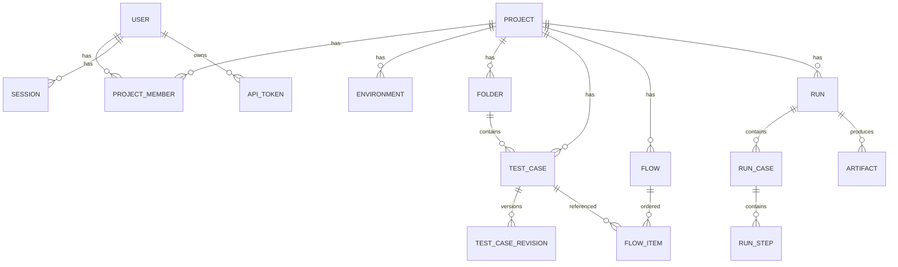

# 03 — Domain Model

## Relasi



## Tabel (draft)

> Semua `id` bertipe `uuid` (v7, sortable). Semua tabel punya `created_at`, `updated_at` kecuali disebut lain.

### Identitas & akses

**users**
| Kolom | Tipe | Catatan |
|-------|------|---------|
| email | citext unique | |
| name | text | |
| password_hash | text null | null jika user hanya pakai Google / belum set password |
| google_sub | text null unique | di-link saat login Google pertama |
| system_role | enum `admin`,`member` | |
| status | enum `invited`,`active`,`disabled` | |
| last_login_at | timestamptz null | |

**invites** — `user_id`, `token_hash`, `expires_at`, `used_at`, `created_by`

**sessions** — `user_id`, `token_hash`, `user_agent`, `ip`, `expires_at`, `last_seen_at`

**api_tokens** — `user_id`, `name`, `prefix` (mis. `qat_ab12`), `token_hash`, `scopes text[]` (`read`,`write`,`run`), `project_ids uuid[] null` (null = semua project user), `expires_at`, `last_used_at`, `revoked_at`

**projects** — `key` (unik, uppercase 2–10 char, mis. `SHOP`), `name`, `description`, `archived_at`, `created_by`, `next_case_seq`, `next_flow_seq`, `next_run_seq`

**project_members** — PK (`project_id`, `user_id`), `role` enum `maintainer`,`editor`,`viewer`

**environments** — `project_id`, `name`, `variables jsonb` (plain), `secrets bytea` (AES-256-GCM, master key dari env), `is_default`

### Test management

**folders** — `project_id`, `parent_id null`, `name`, `position`

**test_cases**
| Kolom | Tipe | Catatan |
|-------|------|---------|
| project_id, folder_id | uuid | folder null = root |
| seq | int | key tampil: `SHOP-T12` |
| title | text | |
| description, preconditions | text | markdown |
| priority | enum `low`,`medium`,`high`,`critical` | |
| status | enum `draft`,`ready`,`deprecated` | hanya `ready` yang direkomendasikan masuk flow |
| execution | enum `automated`,`manual` | default `automated`; `manual` = dikerjakan tester |
| tags | text[] | index GIN |
| variables | jsonb | default variable level test case |
| steps | jsonb | array step, divalidasi JSON Schema ([04](04-test-definition.md)) |
| revision | int | naik setiap save |
| last_run_status | enum null | denormalisasi untuk list view |
| created_by, updated_by | uuid | |
| deleted_at | timestamptz null | soft delete |

**test_case_revisions** — PK (`test_case_id`, `revision`), `snapshot jsonb`, `author_id`, `change_note`, `created_at`

**flows** — `project_id`, `seq` (key `SHOP-F3`), `name`, `description`, `tags`, `shared_session bool`, `stop_on_failure bool`, `variables jsonb`, `revision`, `deleted_at`

**flow_items** — `flow_id`, `position`, `test_case_id`, `continue_on_failure bool`, `enabled bool`

### Eksekusi

**runs**
| Kolom | Tipe | Catatan |
|-------|------|---------|
| project_id, seq | | key tampil: `SHOP-R105` |
| kind | enum `test_case`,`flow` | |
| test_case_id / flow_id | uuid null | salah satu terisi |
| environment_id | uuid null | |
| status | enum `queued`,`running`,`awaiting_manual`,`passed`,`failed`,`blocked`,`error`,`cancelled` | |
| assignee_id | uuid null | tester yang mengerjakan bagian manual (default: pemicu run) |
| resume_position | int null | posisi item flow untuk dilanjutkan setelah bagian manual selesai |
| cancel_requested | bool | |
| options | jsonb | browser, headless, viewport, screenshot, video, timeout, retries |
| snapshot | jsonb | test case/flow/env variable saat run dibuat (secret hanya nama, bukan nilai) |
| trigger | enum `manual`,`mcp`,`api`,`schedule` | |
| triggered_by | uuid | user (juga untuk token) |
| api_token_id | uuid null | jika via token |
| summary | jsonb | `{cases:{total,passed,failed,skipped}, steps:{...}}` |
| error_message | text null | untuk status `error` (infra) |
| queued_at, started_at, finished_at | timestamptz | |

**run_cases** — `run_id`, `position`, `test_case_id`, `test_case_revision`, `title`, `execution` (`automated`/`manual`), `status`, `executed_by null` (manual), `started_at`, `finished_at`, `video_artifact_id null`

**run_steps** — `run_case_id`, `position`, `step_id`, `action`, `description`, `status` (`pending`,`running`,`passed`,`failed`,`blocked`,`skipped`,`error`), `duration_ms`, `error_message`, `actual_result text null` (catatan tester), `screenshot_artifact_id null`, `details jsonb` (mis. request/response ringkas untuk HTTP step, nilai aktual vs expected)

**artifacts** — `project_id`, `run_id`, `run_case_id null`, `run_step_id null`, `kind` (`screenshot`,`video`,`trace`,`log`,`attachment`), `uploaded_by null` (attachment dari tester), `storage_key`, `mime`, `size_bytes`, `expires_at`

### Audit

**audit_logs** — `actor_user_id`, `actor_token_id null`, `project_id null`, `action` (mis. `test_case.update`), `entity_type`, `entity_id`, `meta jsonb`, `created_at`

## Aturan status

```
Run:   queued → running → passed | failed | blocked | error | cancelled
       queued → cancelled
       (manual)  queued/running → awaiting_manual → running (lanjut item flow berikutnya) | final
Step:  pending → running → passed | failed | error ; skipped (setelah kegagalan / disabled)
       (manual)  pending → passed | failed | blocked | skipped
```

- `blocked` = tester tidak bisa menjalankan step (mis. environment down, data tidak tersedia). Case/run `blocked` jika ada step blocked dan tidak ada yang failed.

- `failed` = assertion/aksi gagal (selector tidak ketemu, expect tidak cocok) → kesalahan di aplikasi/test.
- `error` = masalah infrastruktur (browser gagal launch, worker mati, storage error) → bukan kesalahan aplikasi.
- Status run = `failed` jika ada case gagal; `error` jika ada infra error; `passed` jika semua case passed (case yang di-skip karena `enabled=false` tidak dihitung gagal).
