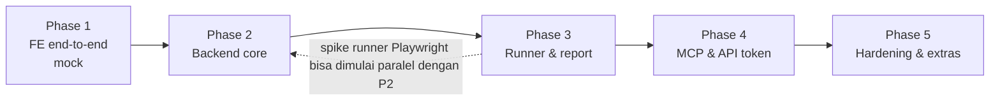

# 10 — Roadmap & Phases

Urutan sengaja **frontend dulu**: Phase 1 membangun seluruh user journey di FE dengan backend palsu (MSW) supaya flow & UX bisa divalidasi end-to-end sebelum investasi di backend. Kontrak API (`openapi.yaml`) yang lahir di Phase 1 menjadi spesifikasi Phase 2.

## Checklist progres

> Ditandai oleh koordinator setelah verifikasi (build/test). `[x]` = selesai & terverifikasi, `[~]` = sedang dikerjakan, `[ ]` = belum.

**Phase 1 — Frontend end-to-end (mock)**
- [x] Kontrak API v0 (`api/openapi.yaml`) + types FE
- [x] Mock API (MSW) + seed + simulator run, jalan juga via `http://<ip>`
- [x] Semua halaman & journey J1–J12 (e2e 10 tes lolos)
- [x] i18n: default English, bisa ganti Bahasa Indonesia di pengaturan akun (tersimpan di profil)

**Phase 2 — Backend core**
- [x] Fondasi Go: config, DB + migrasi skema lengkap, httpx, authz, audit
- [x] Auth: email/password, session + CSRF, rate limit, invite, Google OIDC, API token (Google round-trip asli belum bisa diuji tanpa client ID)
- [x] User & admin (`/me`, `/admin/users`, token)
- [x] Project, member, stats, environment + secret terenkripsi (AES-256-GCM)
- [x] Folder, test case (validasi DSL, revisi, bulk), flow
- [x] FE mode `real` (proxy `/api`, CSRF header, `/auth/config`, SSE) — e2e real 9 lolos + 1 skip (Google mock-only), 426 respons cocok dengan OpenAPI
- [x] Run manual end-to-end di backend (hasil per step, lampiran, complete, flow campuran lanjut)

**Phase 3 — Runner & reporting**
- [x] Runner Node + Playwright resmi (protokol NDJSON) + demo target app (19 tes integrasi)
- [x] Worker Go (River), supervisor runner, enqueue transaksional, cancel, timeout, crash recovery
- [x] Artifact store lokal + S3 (Garage; `QATLAS_STORAGE=s3`, migrasi `qatlas artifacts migrate|check`) + retention, SSE live progress
- [x] Flow run (shared/isolated, stop on failure, campuran manual), retries, re-run failed

**Phase 4 — MCP & API token**
- [x] MCP server (19 tools, report + screenshot sebagai gambar), rate limit per token, proxy `mcp-stdio` (`inspect_page` belum)

**Phase 5 — Hardening & extras**
- [x] Deployment: Dockerfile server/worker, docker-compose, systemd + install/rollback script, Makefile & release tarball (belum diuji di LXC Proxmox asli)
- [x] Demo seed backend (`qatlas seed demo`) terhadap demo target + `scripts/e2e-real.sh`
- [x] JUnit export & contoh CI trigger: `GET /runs/{runKey}/junit.xml` (+ menu "Download JUnit XML" di halaman run, juga di mock), `scripts/qatlas-ci.sh` (start → poll → JUnit, exit 0/1/2) dan contoh GitHub Actions di [`docs/ci/`](ci/README.md); Bitbucket Pipelines belum ada contoh
- [x] README + manual pengguna (EN + ID) dengan 39 screenshot, 3 video MP4 & GIF preview (`docs/manual/`)

**Phase 6 — Peningkatan (setelah review 2026-11-04)**
- [x] Penyimpanan artifact di S3 self-hosted (`QATLAS_STORAGE=s3`, diuji dengan Garage v2.5.0) + `qatlas artifacts migrate/check` — instance demo masih lokal sampai access key Garage diisi
- [x] DSL: `{{fn.totp …}}` (2FA TOTP), `save_regex` + `regex_decode`, polling di `http_request` (runner 42 tes, validasi TS = Go)
- [x] Demo: alur daftar + verifikasi email (Mailpit v1.33.0) dan login TOTP di toko demo; SHOP-T20–T22 lolos dengan runner asli
- [x] Frontend: code-splitting (login 524 → 215 KB gzip, dashboard 253 KB) + gzip aset statis di server Go
- [x] Pengaturan storage dari UI (DB terenkripsi, ganti tanpa restart, migrasi dari UI)
- [x] Responsive testing ([14](14-responsive-testing.md)): katalog device dengan emulasi Playwright (touch, DPR, isMobile, UA), run multi-device dengan laporan matrix, step `set_viewport` / `expect_no_horizontal_scroll` / `only_on`, demo SHOP-F5 di toko demo (bug overflow disengaja di HP)

---

## Phase 1 — Frontend end-to-end (mock)

> **Status (2026-11-04): diimplementasi, menunggu sign-off Kalfian.** J1, J2, J4–J12 otomatis di `web/e2e` (10 tes, lolos terhadap build produksi); J3 diverifikasi manual lewat script Playwright. Unit test 16/16, typecheck, lint, build hijau. Catatan terbuka: bundle JS ±1,5 MB (perlu code-splitting), filter list test case masih single-select per field.

**Tujuan**: semua user journey bisa diklik dari login sampai membaca report, dengan data realistis, tanpa backend. Output utama: validasi flow/UX + kontrak API v0.

### Milestone

| # | Milestone | Isi |
|---|-----------|-----|
| 1.1 | Fondasi | Monorepo (`web/`, `api/`, `docs/`), Vite+React+TS, Tailwind+shadcn, router, layout (sidebar project, topbar, command palette), arahan desain dari UI/UX agent, `openapi.yaml` v0, generate types, MSW + mock DB + seed + dev toolbar |
| 1.2 | Auth & user | Login email/password, login Google (simulasi: terdaftar vs tidak), halaman invite/set password, route guard, logout, `/admin/users` (buat user → salin invite link, ubah role, disable), profile |
| 1.3 | Project | Daftar & buat project, dashboard project, member & role, environment (variable + secret write-only), setting default opsi run |
| 1.4 | Test case | Tree folder (buat/rename/pindah), tabel + filter/search (state di URL), bulk action, detail test case, **step editor** (palette action, form dinamis dari schema, drag urut, duplikat/disable/hapus, toggle JSON), validasi per step, riwayat revisi (lihat & bandingkan sederhana) |
| 1.5 | Flow | Daftar flow, flow builder (cari & tambah test case, drag urut, continue_on_failure per item, shared session, stop on failure) |
| 1.6 | Run & report | Run dialog (env, browser, screenshot mode, video mode, retries), simulasi run, halaman run live (polling), report per case/step, lightbox screenshot, video player, cancel, re-run / re-run failed, riwayat run + filter |
| 1.6b | Manual | Test case `manual` (editor instruksi + expected), mode eksekusi manual (pass/fail/blocked/skip, actual result, lampiran), `/my-tasks`, flow campuran berhenti & lanjut |
| 1.7 | Token & MCP (UI saja) | `/settings/tokens`: buat token (ditampilkan sekali), revoke, snippet setup MCP |
| 1.8 | Polish & verifikasi | State loading/empty/error, RBAC di UI (viewer tidak melihat tombol edit/run), responsive, a11y keyboard, dark mode, review UI/UX, e2e Playwright untuk journey utama |

### User journey yang wajib lolos (acceptance)

| ID | Journey |
|----|---------|
| J1 | Admin login → buat user baru → salin invite link → (sebagai user baru) set password → login |
| J2 | User tidak terdaftar mencoba "Login with Google" → ditolak dengan pesan jelas |
| J3 | Admin buat project `SHOP` → tambah member editor & viewer → buat environment `staging` dengan secret |
| J4 | Editor buat folder → buat test case UI 6 step + test case API 4 step → simpan → revisi tercatat |
| J5 | Editor jalankan test case dengan screenshot `every_step` + video `always` → lihat progres live → report passed dengan screenshot & video |
| J6 | Run yang gagal → report menyorot step gagal, pesan error expected vs actual, screenshot → edit test case → re-run → passed |
| J7 | Editor susun flow 3 test case (shared session) → run → report per case, video satu file |
| J8 | Viewer hanya bisa melihat; tidak ada tombol edit/run/settings |
| J9 | User buat API token → melihat snippet MCP → revoke token |
| J10 | Riwayat run bisa difilter (status/target/tanggal) dan dashboard menampilkan pass rate |
| J11 | Editor buat test case manual → run → kerjakan step (1 failed + lampiran screenshot) → report menampilkan hasil manual |
| J12 | Flow campuran (automated → manual → automated) → run berhenti `awaiting_manual` → muncul di `/my-tasks` assignee → setelah diselesaikan, flow lanjut otomatis |

### Exit criteria
- J1–J12 lolos (manual walkthrough + e2e Playwright untuk J1, J4, J5, J6, J7, J11, J12).
- `pnpm lint`, `typecheck`, `test`, `build` hijau.
- Review UI/UX selesai dan temuan kritis diperbaiki.
- `openapi.yaml` v0 di-review & disetujui → dibekukan sebagai baseline Phase 2 (perubahan selanjutnya lewat diff yang jelas).
- **Sign-off Kalfian** bahwa flow end-to-end sudah oke.

---

## Phase 2 — Backend core

**Tujuan**: semua fitur Phase 1 **kecuali eksekusi run** memakai backend asli.

- Skeleton Go (`cmd/qatlas`, config, slog, chi, oapi-codegen dari `openapi.yaml`), Postgres + goose + sqlc, docker-compose dev.
- Auth: argon2id, session cookie + CSRF, rate limit, invite, Google OIDC (hanya user terdaftar), CLI `user create-admin`.
- User admin, project, member, RBAC (`authz.Can`), environment + enkripsi secret.
- Folder, test case (validasi JSON Schema, revisi, optimistic concurrency), flow.
- Audit log.
- FE: `VITE_API_MODE=real`; mock tetap dipertahankan untuk dev & test FE.
- **Run manual end-to-end** (tidak butuh runner): create run, hasil per step, lampiran, complete, `/my-tasks`.
- Endpoint run automated dibuat tapi eksekusi masih **stub** (run langsung `error: runner not available`) atau dimatikan via feature flag.
- Packaging awal: `docker-compose` (postgres + server) dan build manual (binary + systemd unit) untuk LXC — lihat [12](12-deployment.md). Instance staging di LXC agar bisa dicoba.

**Exit**: J1–J4, J8, J11 lolos terhadap backend asli; unit & integration test (Postgres via testcontainers) untuk auth, RBAC, test case; test keamanan dasar (login brute force, akses lintas project ditolak, Google email tidak terdaftar ditolak).

---

## Phase 3 — Runner & reporting

- **Spike** runner Node + Playwright resmi (lihat [06](06-runner.md)) → keputusan model proses runner. Bisa dimulai paralel dengan Phase 2.
- River queue, `qatlas worker`, enqueue transaksional, concurrency, timeout, cancel, crash recovery.
- Supervisor runner di Go (spawn, protokol NDJSON, restart, kill) + masker secret.
- Runner TypeScript: mapping selector → locator, semua action UI & HTTP (`APIRequestContext`), interpolasi runtime, screenshot, video.
- ArtifactStore (local + S3), upload screenshot/video, retention job.
- Events: LISTEN/NOTIFY → SSE; FE `useRunProgress` pindah ke SSE.
- Flow run (shared session / isolated, stop on failure), retries, re-run failed.
- Flow campuran automated + manual (`resume_position`, job lanjutan).
- Packaging worker: service worker di `docker-compose` dan instalasi manual (Node + browser Playwright + systemd) di LXC.
- Dashboard stats.
- Docker image worker (berbasis image Playwright resmi + binary Go + runner).

**Exit**: J5–J7, J10, J12 lolos dengan browser asli terhadap aplikasi contoh (bisa dibuat app demo kecil di repo untuk target test); uji 4 run paralel tanpa kebocoran proses browser; cancel bekerja; artifact terhapus sesuai retention.

---

## Phase 4 — MCP & API token

- API token (hash, scope, project limit, revoke) — UI sudah ada dari Phase 1.
- Bearer auth untuk REST (CI) & `/mcp`.
- MCP server: tools konteks, test case, flow, run, report (screenshot sebagai image), resources & prompts.
- Rate limit per token, audit `trigger=mcp`.
- **4b (stretch)**: `inspect_page` untuk membantu AI menyusun selector.

**Exit**: dari Claude Code, AI bisa menjalankan "contoh sesi AI" di [07](07-mcp.md) end-to-end: buat test case → run → wait → report → perbaiki → passed. Token dengan scope `read` ditolak saat mencoba run.

---

## Phase 5 — Hardening & extras (prioritas ditentukan setelah Phase 4)

- Scheduled run (cron per test case/flow) + notifikasi (Slack/email/webhook) saat gagal.
- Trigger dari CI: endpoint + contoh GitHub Actions/Bitbucket Pipelines, export **JUnit XML**, exit code.
- SMTP: kirim invite & reset password self-service.
- Playwright trace viewer, visual diff screenshot.
- Data-driven test, `include` step, import/export YAML/CSV.
- Observability: `/metrics` Prometheus, structured log, tracing.
- Deployment produksi di Proxmox LXC: hardening compose/systemd, backup Postgres & artifact, TLS via reverse proxy, prosedur upgrade & rollback.
- Notifikasi/pengingat untuk run manual yang menunggu; step manual di tengah test automated.

---

## Cara kerja per phase

1. Explore/plan singkat → konfirmasi scope milestone.
2. Implementasi per milestone, tiap milestone diakhiri lint/typecheck/test/build.
3. Review kode (dan review UI/UX untuk milestone FE).
4. Demo/walkthrough journey terkait → lanjut milestone berikutnya.
